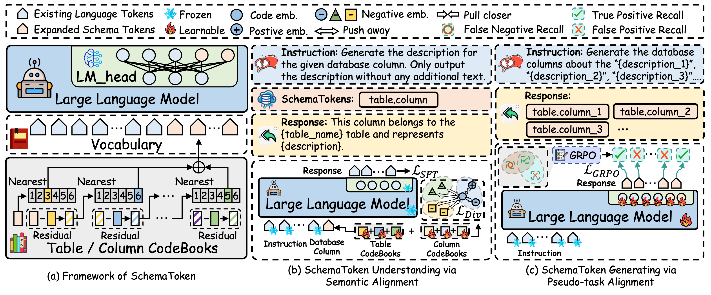

# SchemaToken

This is the pytorch implementation of our manuscript:

> SchemaToken: Tokenizing Database Schemas for Efficient and Robust Text-to-SQL Linking

## Overview
Schema linking is a crucial step in Text-to-SQL systems, connecting natural language mentions to relevant database tables and columns. Despite recent advances in LLM-based Text-to-SQL models, current approaches face two fundamental limitations: (1) providing detailed column descriptions inflates the input context, often exceeding the model’s effective sequence length, and (2) predicting multi-token column names increases output complexity, making the task fragile to generation errors. To address these challenges, we propose SchemaToken, which represents each database column as a dedicated token in the LLM’s vocabulary. This design compresses column semantics into single embeddings, reducing context length and simplifying prediction. We introduce a two-stage training paradigm: (i) Semantic Alignment, which enables the LLM to understand the newly added schema tokens via structured embeddings, and (ii) Pseudo-task Alignment, which trains the LLM to generate these tokens as an unordered set using reinforcement learning with a Jaccard-based reward. Experiments on multiple benchmark datasets demonstrate that SchemaToken significantly improves schema linking performance, particularly for large and complex schemas, while maintaining computational efficiency. 

<p align="center">
  
</p>

# Data Download
Download datasets from the official repository of [Spider](https://yale-lily.github.io/spider) and [BIRD](https://bird-bench.github.io/)

## Files

| File                  | Role                                                                        |
|-----------------------|-----------------------------------------------------------------------------|
| `config.yaml`         | Single source of truth for paths and tiny training budgets.                 |
| `schema_utils.py`     | Common helpers: config loader, schema-token string format, Jaccard helper.  |
| `data_pipeline.py`    | Loads BIRD-dev schema + descriptions, extracts gold columns from each SQL.  |
| `schema_tokens.py`    | RQ-VAE-style codebook, hybrid input embedding, hybrid LM head.              |
| `stage1_train.py`     | Stage 1 SFT: Semantic Alignment with diversity regularisation.              |
| `stage2_train.py`     | Stage 2 GRPO: pseudo-task alignment with Jaccard-similarity reward.         |
| `evaluate.py`         | BIRD-dev schema-linking eval reporting SRR / NSR / NSP / NSF.               |
| `run_all.sh`          | Drives the four scripts above end-to-end.                                   |


## Quick start

```bash
bash run_all.sh
```

The `config.yaml` covers two BIRD databases, 110 schema
tokens, 20 stage-1 micro-steps, 12 stage-2 GRPO steps and 8 eval
questions. End-to-end takes about 2 minutes on a single H20.

## Scaling to all dataset

Edit `config.yaml`:

| Setting                             | Smoke value | Paper value |
|-------------------------------------|-------------|-------------|
| `data.databases`                    | 2 dbs       | all 11      |
| `data.max_dev_questions_per_db`     | 8           | -1 (all)    |
| `schema_token.L_T`, `schema_token.L_C` | 2        | 4           |
| `schema_token.N`                    | 32          | 256         |
| `stage1.max_steps`                  | 20          | 3 epochs    |
| `stage2.num_train_steps`            | 12          | 200         |
| `stage2.num_rollouts`               | 2           | 4           |

